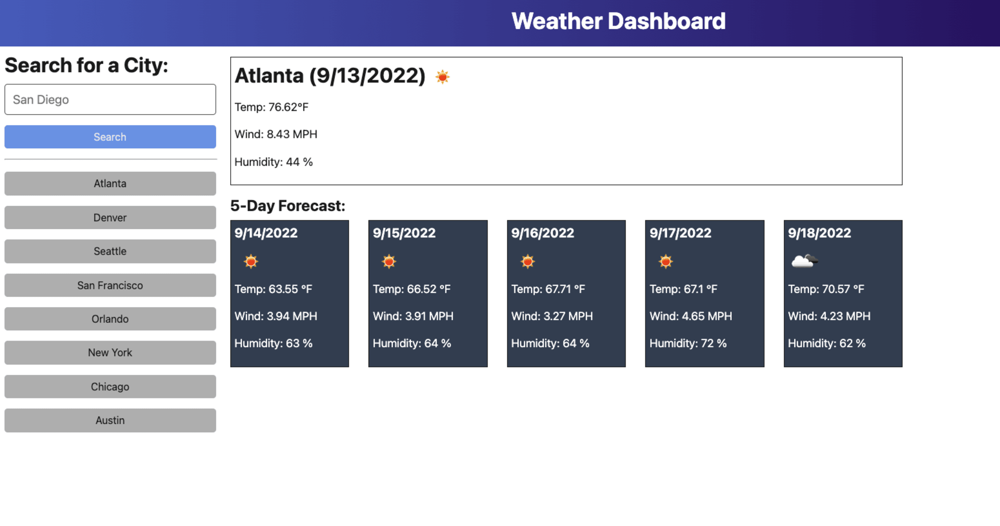

# hw06 Server-Side APIs: Weather Dashboard
5-day weather dashboard using fetch and server-side apis. Michael Sheliga 10.26.26

## Links
Deployed HTML Link: "https://urimjs.github.io/hw06fetchURLVB/"  
GitHub Repo Link: "https://github.com/uriMJS/hw06fetchURLVB.git"   
Screenshot Question Link:    
Screenshot HiScore Link: 
	
## Significant Programming Features   
This project was long, with a few tricky bugs.    
**Javascript** Lots of DOM manipulation, much of it common.  
   - document.createElement, Element.appendChild, Button.addEventListener   
   - Element.remove() used to reset main section  
   - "Global" values kept in the DOM (question-index, time-left, Message, interval-id).  
   - intervalId = setInterval(callback method, time)
      - No inner functions since intervalID kept in DOM  
	  - clearInterval(intervalId) in checkAnswer need not be inisde setInterval  
   - Used two js files. script.js and hiScores.js. 	  
   - Used split(index, length, insertItem) for ordered HiScore list.    
   - **Issue** Buttons displayed in-line, even when inside block or flex-direction column.  
      - Solution: Use a div to surround each button.  
   - Button Click Handler - 4 Methods - onclicks and addEventListener 
      - Documentation at www.xjavascript.com/blog/how-to-set-onclick-with-javascript/   
      - button onclick="handler(event)" tag and button.setAttribute("onclick", "checkAnswer(event)")
         - Note onclick, not onClick  
		 - Both handlers gets quotes, parenthesis and event  
	  - button.onclick = checkAnswer and button.addEventListener("click", handler)  
	     - No handler quotes, parenthesis nor event  
         - addEventListener is only method using "click" instead of "onclick"	
   - **Issue** Form submit button returned to main screen. (Replicated at end of project for testing.)  
      - Solution: Use event.preventDefault  
	  - Note that this problem occurs if handler only has alerts, but not if screen is re-rendered.  
 
**CSS**  
   - Multiple button classes (normal and disabled) with different background-colors.  
      - Use to gray out disabled answer. 
   - Class later in CSS controls the color. class="class1 class2" order does not matter.  
 
**To Learn From**  
   - LocalStorage  
      - Used LocalStorage to Keep HiScores  
         - .removeItem, .setItem, .getItem	 
      - Must Store Strings in LocalStorage => JSON.stringify  
      - Need Array out of LocalStorage => JSON.parse  
   - Disabled button with button.setAttribute("disabled", "disabled")  
      - Second values does NOT matter here. 
	  - Use button.removeAttribute("disabled") to enable.
	  - Inconsistent documentation on button.disabled = false;
	  
**Tools** (Aint nothing more important than your tools)  
   - Webpage Debugger. CNTL-SHIFT-J  
      - Set breakpoints and inspected variables.  
      - LocalStorage. Found and deletable under Attributes tab.  
	  - CSS values. Can find striken DOM properties, such as margin, but not why they were striken.
	  
## Notes  
No starter code (Just a demo png file) for this project.   
**All code, including CSS written from scratch.**    
The programming was pretty straight-forward, but long. Lots of adding elements to DOM.   
Screenshot Link: This image seems to only show up in github.  
For screenshot ![Text] is just explanatory text.   
Deployment: To create githubio deployment    
   - Go to the repo (github.com/uriMJS/uriHW04jsTimedQuizVB).   
   - Click on the **Settings** button.  2nd Row of Icons from top, far right.  
   - Click on the Pages button.  Left menu list, about 60% down.  
   - Github Pages Screen Should Appear  
      - Click on Source -> Deploy From a Branch (near screen center)  
	  - Click on Branch -> main: root (just below Source)  

## Acceptance Criteria  
	Click the start button: timer starts and I am presented with a question  
	answer a question, presented with another question
	answer a question incorrectly, time (15) is subtracted from the clock
	all questions are answered or the timer reaches 0, game is over
	game is over, can save my initials and score.  
	Note Tweaks: Total time of 10, wrong answer => 5 second penalty and disabled button. 


## Project Goals  
Use the 3rd party openweatehrmap API, jQuery, fetch, local storage and a the BootStrap CSS framework, to create a 5-day weather application.  
The user will type a city name into a form, upon submit the API will be used to get latitude-longitude for the city, and the  
API will then be used to get the 5 day weather forecast. If the city exists it will be saved to local storage.    
A sample API call: api.openweathermap.org/data/2.5/forecast?lat={lat}&lon={lon}&appid={API key} 2603ab2cb7ddafbe94e3a350338be59b  
Note that using this key in a public repo effectively makes the openweathermap key public.  


## Acceptance Criteria   
```  
Weather outlook for multiple cities weather dashboard with form inputs,  
search for a city => current and future conditions for city and city is added to the search history   
Current weather conditions include: city name, the date, an icon of weather conditions, temperature, humidity, and wind speed  
Future weather conditions include: a 5-day forecast with date, an icon of weather conditions, temperature, wind speed, and humidity   
Click on a city in search history:  presented with current and future conditions for that city 
```  

## Your Task
Use the [5 Day Weather Forecast](https://openweathermap.org/forecast5)   
The base URL should look like the following: `https://api.openweathermap.org/data/2.5/forecast?lat={lat}&lon={lon}&appid={API key}`.  
After registering for a new API key, you may need to wait up to 2 hours for that API key to activate.

**Hint**: Using the 5 Day Weather Forecast API, you'll notice that you will need to pass in coordinates instead of just a city name.   
Using the OpenWeatherMap APIs, how could we retrieve geographical coordinates given a city name?

You will use `localStorage` to store any persistent data.  
For more information on how to work with the OpenWeather API,   
refer to the [Full-Stack Blog on how to use API keys](https://coding-boot-camp.github.io/full-stack/apis/how-to-use-api-keys).  

## Mock-Up

The following image shows the web application's appearance and functionality:



